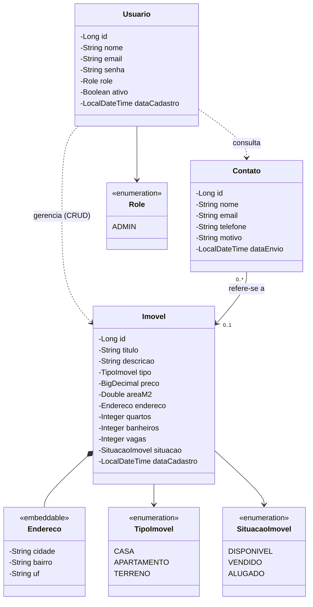

# Modelagem de Domínio / Entidades - Sistema de Gestão de Imóveis

## 1. Diagrama de Classes

### Legenda

- `*--` : composição (o `Endereco` faz parte do imóvel)
- `-->` : associação (a classe usa o enum ou referencia a outra entidade)
- `..>` : dependência (o admin gerencia imóveis e consulta contatos pelas rotas `/admin/**`, sem vínculo no banco)
- `<<embeddable>>` : objeto embutido na tabela do imóvel
- `<<enumeration>>` : enum Java

### Decisões de modelagem

- **Classe única:** `Casa`, `Apartamento` e `Terreno` não têm atributos exclusivos, então não justificam classes separadas. O tipo é definido pelo enum `TipoImovel`.
- **RN03 (terreno sem quartos, banheiros e vagas):** validada no `ImovelService`. Quando o tipo é `TERRENO`, esses campos ficam nulos.
- **RN08 (exclusão de imóvel com contatos):** o contato é mantido com `imovel` nulo, preservando o histórico.
- **Evolução:** se surgirem atributos exclusivos de um tipo (ex.: andar e condomínio para apartamento), dá para migrar para herança depois.

## 2. Descrição das Entidades

### Imovel
Representa um imóvel cadastrado pela construtora (casa, apartamento ou terreno).
- `id`: identificador único
- `titulo`: título do anúncio (obrigatório, usado na busca do RF03)
- `descricao`: texto descritivo (opcional)
- `tipo`: `CASA`, `APARTAMENTO` ou `TERRENO` (obrigatório)
- `preco`: valor do imóvel (obrigatório, maior que zero, RN02)
- `areaM2`: área em m² (obrigatória, maior que zero, RN02)
- `endereco`: cidade, bairro e UF (objeto embutido)
- `quartos`, `banheiros`, `vagas`: quantidades (nulos quando o tipo é `TERRENO`, RN03)
- `situacao`: `DISPONIVEL`, `VENDIDO` ou `ALUGADO` (obrigatória)
- `dataCadastro`: preenchida automaticamente (`@PrePersist`), usada na ordenação do RF02

### Endereco (embeddable)
Objeto de valor, sem tabela própria: as colunas ficam dentro de `imovel`.
- `cidade`: nome da cidade
- `bairro`: nome do bairro
- `uf`: sigla do estado (2 caracteres)

### Usuario
Representa o admin do sistema.
- `id`: identificador único
- `nome`: nome completo (obrigatório)
- `email`: único (RN05, retorna 409 se duplicado)
- `senha`: guardada com hash (BCrypt), nunca em texto puro, com no mínimo 8 caracteres (RN06)
- `role`: sustenta o 401/403 das rotas administrativas (RF06)
- `ativo`: permite desativar um admin (RN07: ninguém desativa a si mesmo nem o último admin ativo)
- `dataCadastro`: preenchida automaticamente (`@PrePersist`)

O primeiro admin é criado por migration/seed (RF10), com credenciais vindas de variáveis de ambiente (RNF10). Não existe endpoint público de cadastro (RF11).

### Contato
Mensagem enviada por um visitante (sem login) pelo site.
- `id`: identificador único
- `nome`: nome de quem enviou (obrigatório)
- `email`: formato válido (RN01)
- `telefone`: formato válido (RN01)
- `motivo`: texto com o motivo do contato (obrigatório)
- `dataEnvio`: preenchida automaticamente, usada no filtro por data do RF08
- `imovel`: referência opcional ao imóvel de interesse, usada no filtro por imóvel do RF08. Se o imóvel for excluído, o campo fica nulo (RN08)

Por causa da LGPD (RNF13), só são coletados esses campos e o acesso é restrito ao admin.

### Enums

| Enum | Valores |
|------|---------|
| `TipoImovel` | `CASA`, `APARTAMENTO`, `TERRENO` |
| `SituacaoImovel` | `DISPONIVEL`, `VENDIDO`, `ALUGADO` |
| `Role` | `ADMIN` |

## 3. Relacionamentos

| Origem | Destino | Cardinalidade | Observação |
|--------|---------|---------------|------------|
| Contato | Imovel | N para 0..1 | Opcional; vira nulo ao excluir o imóvel (RN08) |
| Imovel | Endereco | 1 para 1 | Embutido na tabela `imovel` |
| Usuario | Imovel | sem vínculo no banco | Relação conceitual: o admin gerencia via `/admin/**` |
| Usuario | Contato | sem vínculo no banco | Relação conceitual: o admin consulta via `/admin/**` |