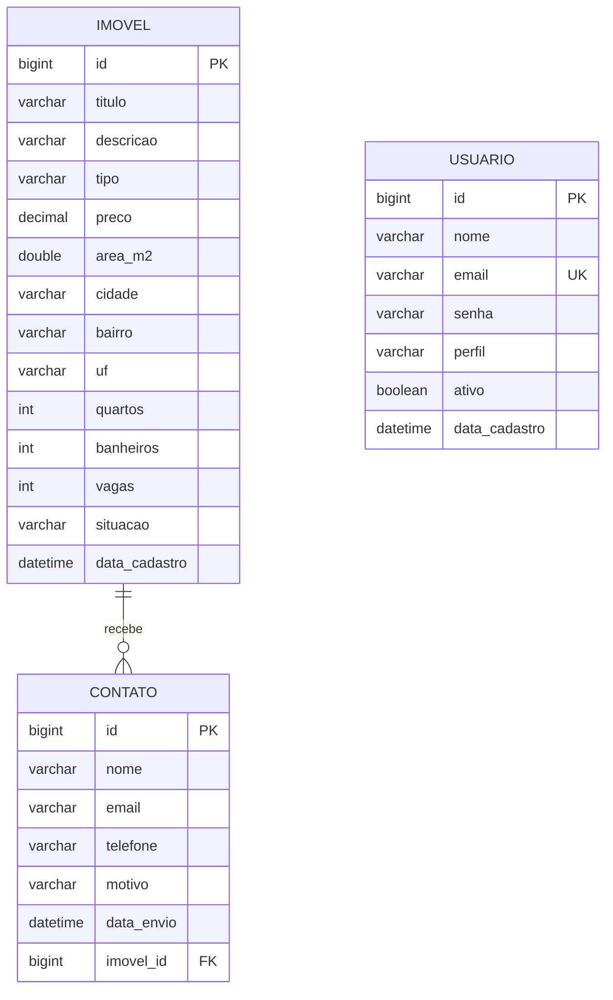

# Modelagem do Banco de Dados

> Continuação da Modelagem de Domínio. Não há herança JPA: o modelo usa uma **classe única `Imovel`** com o campo `tipo` (enum `TipoImovel`), então existe uma única tabela `imovel`. O `Endereco` é um objeto embutido (`@Embeddable`), e suas colunas ficam dentro de `imovel`. Migrations gerenciadas via **Flyway** em `src/main/resources/db/migration`.
>
> Os enums (`tipo`, `situacao`, `perfil`) são gravados como texto (`@Enumerated(EnumType.STRING)`).

## 1. Diagrama Entidade-Relacionamento (visão textual)



> `USUARIO` não tem chave estrangeira com as outras tabelas. A relação "admin gerencia imóveis e consulta contatos" é feita pelo controle de acesso (JWT nas rotas `/admin/**`), não por coluna no banco.

## 2. Definição das Tabelas

### `imovel`
| Coluna | Tipo | Restrições |
|--------|------|------------|
| id | BIGINT | PK, AUTO_INCREMENT |
| titulo | VARCHAR(150) | NOT NULL |
| descricao | VARCHAR(2000) | NULL |
| tipo | VARCHAR(20) | NOT NULL (`CASA`, `APARTAMENTO`, `TERRENO`) |
| preco | DECIMAL(15,2) | NOT NULL, CHECK > 0 (RN02) |
| area_m2 | DOUBLE | NOT NULL, CHECK > 0 (RN02) |
| cidade | VARCHAR(100) | NOT NULL (embutido de `Endereco`) |
| bairro | VARCHAR(100) | NOT NULL (embutido de `Endereco`) |
| uf | VARCHAR(2) | NOT NULL (embutido de `Endereco`) |
| quartos | INT | NULL (nulo quando `TERRENO`, RN03) |
| banheiros | INT | NULL (nulo quando `TERRENO`, RN03) |
| vagas | INT | NULL (nulo quando `TERRENO`, RN03) |
| situacao | VARCHAR(20) | NOT NULL (`DISPONIVEL`, `VENDIDO`, `ALUGADO`) |
| data_cadastro | DATETIME | NOT NULL, default CURRENT_TIMESTAMP |

### `usuario`
| Coluna | Tipo | Restrições |
|--------|------|------------|
| id | BIGINT | PK, AUTO_INCREMENT |
| nome | VARCHAR(150) | NOT NULL |
| email | VARCHAR(150) | NOT NULL, UNIQUE (RN05) |
| senha | VARCHAR(100) | NOT NULL (hash BCrypt, nunca texto puro) |
| perfil | VARCHAR(20) | NOT NULL (`ADMIN`) |
| ativo | BOOLEAN | NOT NULL, default TRUE |
| data_cadastro | DATETIME | NOT NULL, default CURRENT_TIMESTAMP |

### `contato`
| Coluna | Tipo | Restrições |
|--------|------|------------|
| id | BIGINT | PK, AUTO_INCREMENT |
| nome | VARCHAR(150) | NOT NULL |
| email | VARCHAR(150) | NOT NULL |
| telefone | VARCHAR(20) | NOT NULL |
| motivo | VARCHAR(1000) | NOT NULL |
| data_envio | DATETIME | NOT NULL, default CURRENT_TIMESTAMP |
| imovel_id | BIGINT | NULL, FK → imovel(id), ON DELETE SET NULL (RN08) |

> As buscas do RF02 (ordenação por preço e data de cadastro) e do RF08 (filtro de contatos por data) usam as colunas `preco`, `data_cadastro` e `data_envio`, por isso elas têm índice. O filtro de contatos por imóvel usa `imovel_id`, que já é indexado pela chave estrangeira no MySQL.

## 3. Script de Migration (Flyway) — `V1__create_schema.sql`

```sql
CREATE TABLE imovel (
    id BIGINT AUTO_INCREMENT PRIMARY KEY,
    titulo VARCHAR(150) NOT NULL,
    descricao VARCHAR(2000),
    tipo VARCHAR(20) NOT NULL,
    preco DECIMAL(15,2) NOT NULL,
    area_m2 DOUBLE NOT NULL,
    cidade VARCHAR(100) NOT NULL,
    bairro VARCHAR(100) NOT NULL,
    uf VARCHAR(2) NOT NULL,
    quartos INT,
    banheiros INT,
    vagas INT,
    situacao VARCHAR(20) NOT NULL,
    data_cadastro DATETIME NOT NULL DEFAULT CURRENT_TIMESTAMP,
    CONSTRAINT ck_imovel_tipo CHECK (tipo IN ('CASA', 'APARTAMENTO', 'TERRENO')),
    CONSTRAINT ck_imovel_situacao CHECK (situacao IN ('DISPONIVEL', 'VENDIDO', 'ALUGADO')),
    CONSTRAINT ck_imovel_preco CHECK (preco > 0),
    CONSTRAINT ck_imovel_area CHECK (area_m2 > 0),
    CONSTRAINT ck_imovel_terreno CHECK (
        tipo <> 'TERRENO' OR (quartos IS NULL AND banheiros IS NULL AND vagas IS NULL)
    )
);

CREATE INDEX idx_imovel_preco ON imovel (preco);
CREATE INDEX idx_imovel_data_cadastro ON imovel (data_cadastro);

CREATE TABLE usuario (
    id BIGINT AUTO_INCREMENT PRIMARY KEY,
    nome VARCHAR(150) NOT NULL,
    email VARCHAR(150) NOT NULL UNIQUE,
    senha VARCHAR(100) NOT NULL,
    perfil VARCHAR(20) NOT NULL,
    ativo BOOLEAN NOT NULL DEFAULT TRUE,
    data_cadastro DATETIME NOT NULL DEFAULT CURRENT_TIMESTAMP
);

CREATE TABLE contato (
    id BIGINT AUTO_INCREMENT PRIMARY KEY,
    nome VARCHAR(150) NOT NULL,
    email VARCHAR(150) NOT NULL,
    telefone VARCHAR(20) NOT NULL,
    motivo VARCHAR(1000) NOT NULL,
    data_envio DATETIME NOT NULL DEFAULT CURRENT_TIMESTAMP,
    imovel_id BIGINT,
    CONSTRAINT fk_contato_imovel FOREIGN KEY (imovel_id) REFERENCES imovel(id) ON DELETE SET NULL
);

CREATE INDEX idx_contato_data_envio ON contato (data_envio);
```

## 4. Script de Seed do Primeiro Administrador — `V2__seed_admin_inicial.sql`

```sql
INSERT INTO usuario (nome, email, senha, perfil, ativo)
VALUES ('${admin_nome}', '${admin_email}', '${admin_senha_hash}', 'ADMIN', TRUE);
```

Os valores entre `${...}` são *placeholders* do Flyway, preenchidos a partir de variáveis de ambiente (RNF10), então nada fica fixo no código:

```properties
# application.properties
spring.flyway.placeholders.admin_nome=${ADMIN_NOME}
spring.flyway.placeholders.admin_email=${ADMIN_EMAIL}
spring.flyway.placeholders.admin_senha_hash=${ADMIN_SENHA_HASH}
```

## 5. Rastreabilidade: regra x banco

| Regra | Onde é garantida no banco |
|-------|---------------------------|
| RN02 (preço e área maiores que zero) | `ck_imovel_preco` e `ck_imovel_area` |
| RN03 (terreno sem quartos, banheiros e vagas) | `ck_imovel_terreno` |
| RN05 (e-mail de usuário único) | `UNIQUE` em `usuario.email` |
| RN08 (excluir imóvel mantém o contato) | `ON DELETE SET NULL` em `contato.imovel_id` |
| RF10 (primeiro admin por seed) | `V2__seed_admin_inicial.sql` |
| RNF04 (schema versionado) | Scripts Flyway em `db/migration` |

As demais regras (RN01 formato de e-mail e telefone, RN06 tamanho mínimo da senha, RN07 último admin ativo, RN09 mensagem de login) não têm como ser garantidas só pelo banco e ficam na aplicação (validação de DTO e services).

## 6. Observações

- As regras RN02 e RN03 ficam **duplicadas de propósito**: o service valida primeiro e devolve `400` com uma mensagem clara, e o `CHECK` no banco é a segunda proteção caso algum dado entre por outro caminho. Os `CHECK` são aplicados no MySQL 8.0.16 ou superior e no H2.
- A `senha` guarda o **hash BCrypt** (60 caracteres, por isso `VARCHAR(100)` com folga). O seed recebe o hash pronto pela variável `ADMIN_SENHA_HASH`, porque o SQL não gera BCrypt.
- **LGPD (RNF13):** `contato` guarda dados pessoais (nome, e-mail e telefone). Coletar só esses campos e expor a tabela apenas em rotas `/admin/**`.
- `area_m2` foi definida como `DOUBLE` para bater com o `Double areaM2` da entidade. Se preferir `BigDecimal` na entidade, troque a coluna para `DECIMAL(10,2)`.
- A busca por título (RF03) com `LIKE '%termo%'` não usa índice comum. Para o volume esperado isso não é problema, e não foi criado índice nessa coluna.
- Para H2 (perfil `test`), o mesmo script roda sem alteração, usando `spring.flyway.locations=classpath:db/migration`. Se algum comando não for aceito, adicione `MODE=MySQL` na URL do H2.
- O `V2` depende das variáveis de ambiente `ADMIN_*` estarem definidas. Nos testes, defina valores fictícios no `application-test.properties`.